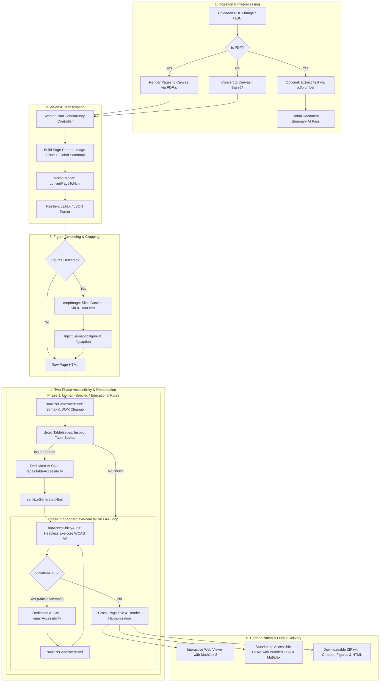

# AccessDocs Architecture Guide

This document details the end-to-end architecture of **AccessDocs**, explaining how raw input files (scanned lecture slides, problem sets, handwritten notes, and PDFs) are ingested, transcribed, enriched, repaired for accessibility, and exported as standalone accessible HTML documents.

---

## 1. End-to-End Pipeline Diagram



---

## 2. Pipeline Stages: Input to Output

### Stage 1: Ingestion & Preprocessing

- **Input Formats**: PDF, PNG, JPEG, WebP, and Apple HEIC photos.
- **Client-Side Page Rendering**:
  - PDFs are parsed using `pdfjsLib` in [`pdfService.ts`](file:///c:/Users/think/Desktop/accessible-digitizer/services/pdfService.ts). Each page is rendered to an HTML5 `<canvas>` at $2\times$ viewport scale to maintain high visual fidelity for math subscripts, superscripts, and small diagrams.
  - HEIC files are converted on-the-fly via `heic2any`.
- **Server-Side Text Extraction (`pdfplumber`)**:
  - The frontend queries `/api/pdf/extract` via [`server/pdfExtract.mjs`](file:///c:/Users/think/Desktop/accessible-digitizer/server/pdfExtract.mjs). If Python with `pdfplumber` is available, raw selectable text and glyphs are extracted.
  - This extracted text provides verbatim grounding for terminology, while the page image remains the authority for layout, math notation, and visual figures.
- **Global Context Summarization**:
  - If extracted text is present, `summarizeDocumentText()` in [`aiService.ts`](file:///c:/Users/think/Desktop/accessible-digitizer/services/aiService.ts) generates a 1–2 sentence overview of the document’s mathematical subject matter. This summary is injected into every page's prompt to maintain uniform terminology and notation across slides.

---

### Stage 2: Multimodal Vision AI Transcription

- **Concurrency Worker Pool**:
  - Managed in [`useDigitization.ts`](file:///c:/Users/think/Desktop/accessible-digitizer/hooks/useDigitization.ts). Pages are dispatched through a configurable worker pool (`LLM_CONCURRENCY_LIMIT`) to maximize throughput without exceeding rate limits.
- **Prompt Engineering (`getSystemInstruction`)**:
  - **Language Adaptation**: Selectable levels (`faithful`, `natural`, `fleshed_out`).
  - **Semantic Structure**: Enforces standard HTML5 tags (`<section>`, `<h1>`–`<h3>`, `<ol>`, `<ul>`, `<code>`, `<pre>`).
  - **LaTeX Mathematics**: Strict distinction between inline math (`\( ... \)`) within paragraphs and standalone block equations (`\[ ... \]`).
  - **Tabular Data**: Mandates `<table>`, `<caption>`, `<thead>`, and `<tbody>` with `<th scope="col">`.
  - **Figure Bounding Boxes**: Visual diagrams are demarcated with normalized $[ymin, xmin, ymax, xmax]$ coordinates ($0$–$1000$) and placeholder tags ``.
- **Resilient LaTeX / JSON Parsing (`parseModelJson`)**:
  - Standard `JSON.parse` frequently fails on LaTeX backslashes (`\frac`, `\beta`, `\times`).
  - `parseModelJson` in [`aiService.ts`](file:///c:/Users/think/Desktop/accessible-digitizer/services/aiService.ts) sanitizes JSON strings character-by-character, differentiating between valid JSON escape sequences (`\n`, `\t`, `\"`) and LaTeX math commands (`\nabla`, `\theta`, `\alpha`), ensuring zero JSON parsing errors during conversion.

---

### Stage 3: Figure Grounding & Cropping

- **Coordinate Mapping & Slicing**:
  - `cropImage()` in [`utils/image.ts`](file:///c:/Users/think/Desktop/accessible-digitizer/utils/image.ts) translates the vision model's normalized $0$–$1000$ coordinates into the canvas coordinate space:
    $$\text{pixel}_y = \frac{y_{\text{norm}}}{1000} \times \text{canvas.height}, \quad \text{pixel}_x = \frac{x_{\text{norm}}}{1000} \times \text{canvas.width}$$
- **DOM Replacement**:
  - Temporary `` tags are replaced with semantic `<figure>` elements enclosing the cropped graphic, an interactive figure-editing trigger, and a descriptive `<figcaption aria-hidden="true">`.
- **Interactive Figure Editor**:
  - Users can click any figure in the UI to fine-tune the bounding box, adjust dimensions, or regenerate alt text via [`components/FigureEditor.tsx`](file:///c:/Users/think/Desktop/accessible-digitizer/components/FigureEditor.tsx).

---

### Stage 4: Two-Phase Accessibility & Remediation

To prevent prompt bloat and instruction conflict, remediation is separated into deterministic sanitization, domain-specific rule repairs, and a pure axe-core WCAG loop:

```
Raw HTML ──> [sanitizeGeneratedHtml] ──> [Phase 1: Domain Rules] ──> [Phase 2: axe-core Loop] ──> Final HTML
```

#### A. Deterministic Sanitizer (`sanitizeGeneratedHtml`)
Located in [`utils/accessibility.ts`](file:///c:/Users/think/Desktop/accessible-digitizer/utils/accessibility.ts):
- Cleans slide artifacts, stray page numbers, and empty paragraphs.
- Normalizes heading level sequences (preventing skipped heading levels).
- Fixes MathJax line-break syntax collisions (`\\\\relax [`).
- Strips unsafe inline styling (`color`, `background`) and low-contrast CSS classes.
- Wraps tables in horizontal scroll containers (`.table-wrap`) and ensures every `<th>` has `scope="col"`.
- Injects deterministic fallback brackets `[      ]` and screen-reader prompts `<span class="sr-only">Blank response for [Header]</span>` into any empty `<td></td>` cells.

#### B. Phase 1: Domain-Specific Educational Rules (Dedicated AI Call)
- **Problem**: Homework, exam worksheets, and quizzes often have empty tabular answer spaces.
- **Detection**: `detectTableIssues(html)` inspects all `<table>` elements for empty `<tbody>` tags or data cells lacking content.
- **Repair**: If detected, `repairTableAccessibility(html, issues)` in [`services/aiService.ts`](file:///c:/Users/think/Desktop/accessible-digitizer/services/aiService.ts) executes a targeted, lightweight AI call specifically instructed on table accessibility and accessible form/placeholder inputs.
- **Isolation**: Skipped entirely if no table issues exist, saving tokens and avoiding prompt pollution.

#### C. Phase 2: Standard axe-core WCAG AA Loop (Dedicated AI Call)
- **Headless Audit**: `runAccessibilityAudit(html)` injects the document into a headless DOM container and executes `axe-core` evaluating against WCAG 2.1/2.2 Level AA rulesets (`wcag2a`, `wcag2aa`, `wcag21a`, `wcag21aa`, `wcag22aa`).
- **Score Calculation**: Produces a normalized $0$–$100\%$ score with deductions weighted by severity (`critical: -28`, `serious: -18`, `moderate: -10`, `minor: -4`).
- **Iterative AI Repair**: If violations are found, `repairAccessibility(html, audit)` runs up to 2 repair iterations. The prompt receives structured axe violation objects (target selectors, failure summaries) to perform targeted fixes.

---

### Stage 5: Harmonization & Output Delivery

1. **Cross-Page Harmonization**:
   - Slides frequently repeat document titles or lecture headers at the top of every slide.
   - `useDigitization.ts` compares headings across subsequent pages, converting redundant slide banners into continuation markers to prevent screen readers from re-reading identical headings repeatedly.
2. **Interactive UI View**:
   - Rendered with live **MathJax 3** typeset promises.
   - Includes real-time audit scorecards ([`AccessibilityAuditReport.tsx`](file:///c:/Users/think/Desktop/accessible-digitizer/components/AccessibilityAuditReport.tsx)).
3. **Standalone HTML Export**:
   - Generates an independent, self-contained HTML document featuring:
     - Curated typography (Plus Jakarta Sans & Open Sans).
     - WCAG AA compliant contrast palette with responsive layout tokens.
     - Embedded MathJax 3 configuration for offline and web-accessible math equations.
     - Utility `.sr-only` CSS class for screen-reader text.
     - Print media stylesheet (`@media print`) optimizing page breaks and margins.
4. **ZIP Archive Export**:
   - Bundles the standalone HTML file together with all extracted cropped figures in a `figures/` directory using `JSZip`.

---

## 3. Key Codebase Map

| File Path | Role & Primary Responsibility |
| :--- | :--- |
| [`App.tsx`](file:///c:/Users/think/Desktop/accessible-digitizer/App.tsx) | Main UI coordinator, document preview, standalone HTML generation template, and file downloads. |
| [`hooks/useDigitization.ts`](file:///c:/Users/think/Desktop/accessible-digitizer/hooks/useDigitization.ts) | Pipeline orchestrator: concurrency worker pool, status tracking, figure replacement, and two-phase audit loop. |
| [`services/aiService.ts`](file:///c:/Users/think/Desktop/accessible-digitizer/services/aiService.ts) | LLM interface: vision conversion prompts, resilient JSON/LaTeX parser, figure descriptions, table repair, and axe repair. |
| [`services/pdfService.ts`](file:///c:/Users/think/Desktop/accessible-digitizer/services/pdfService.ts) | Client-side PDF rendering using `pdfjsLib` canvas rendering and backend text extraction coordinator. |
| [`utils/accessibility.ts`](file:///c:/Users/think/Desktop/accessible-digitizer/utils/accessibility.ts) | Deterministic DOM sanitization (`sanitizeGeneratedHtml`), table issue detector (`detectTableIssues`), and headless `axe-core` runner. |
| [`utils/image.ts`](file:///c:/Users/think/Desktop/accessible-digitizer/utils/image.ts) | Canvas image cropping based on normalized 0–1000 coordinates. |
| [`components/AccessibilityAuditReport.tsx`](file:///c:/Users/think/Desktop/accessible-digitizer/components/AccessibilityAuditReport.tsx) | UI audit inspector displaying automated WCAG score, summary checks, and axe violations grouped by impact. |
| [`server/llmProxy.mjs`](file:///c:/Users/think/Desktop/accessible-digitizer/server/llmProxy.mjs) | Backend proxy supporting split text/vision endpoints, delay throttling, timeouts, and OpenRouter reasoning configuration. |
| [`server/pdfExtract.mjs`](file:///c:/Users/think/Desktop/accessible-digitizer/server/pdfExtract.mjs) | Python `pdfplumber` subprocess bridge for server-side PDF text extraction. |

---

## 4. How to Extend the Pipeline

### Adding a New Domain-Specific Rule
If an additional educational or LMS-specific rule is needed (e.g., proof block formatting, formula numbering, or fill-in-the-blank underlines):
1. **Add a Detector** in [`utils/accessibility.ts`](file:///c:/Users/think/Desktop/accessible-digitizer/utils/accessibility.ts) (e.g., `detectProofIssues(html)`).
2. **Add a Dedicated AI Repair Function** in [`services/aiService.ts`](file:///c:/Users/think/Desktop/accessible-digitizer/services/aiService.ts) with a focused system prompt.
3. **Plug into Phase 1** in [`hooks/useDigitization.ts`](file:///c:/Users/think/Desktop/accessible-digitizer/hooks/useDigitization.ts) before the axe-core loop executes.
4. **Add a Deterministic Safety Net** in `sanitizeGeneratedHtml()` to guarantee predictable fallback rendering.
